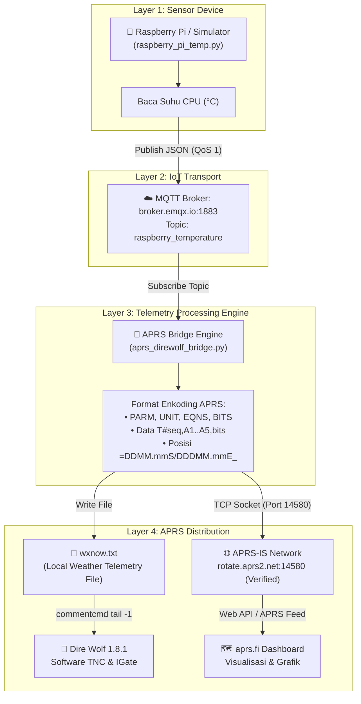

# Laporan UTS — APRS Telemetry dengan Dire Wolf, MQTT & APRS-IS
**Mata Kuliah:** Internet of Things (IoT)  
**Semester:** 5  
**Judul Proyek:** Sistem Telemetri APRS Berbasis Raspberry Pi Temperature Menggunakan Dire Wolf, MQTT, dan Integrasi APRS-IS (aprs.fi)  
**Callsign:** `YD3ADB-3`  

---

## 1. Latar Belakang

APRS (*Automatic Packet Reporting System*) adalah sistem komunikasi radio paket amatir yang digunakan untuk transmisi data real-time, seperti posisi GPS (traking kendaraan/aset), informasi cuaca (*weather station*), dan telemetri sensor lingkungan. APRS bekerja pada pita VHF frekuensi 144.390 MHz (standar IARU Region 3 / Indonesia 144.390 MHz atau 144.800 MHz) dan terhubung secara global ke jaringan internet melalui gateway **APRS-IS** (*APRS Internet System*).

**Dire Wolf** merupakan software TNC (*Terminal Node Controller*) modern yang mengonversi sinyal audio sound card PC/Raspberry Pi menjadi modem paket radio AX.25 (1200 baud AFSK). Selain mentransmisikan data via radio, Dire Wolf memiliki fungsi **IGate (Internet Gateway)** untuk mengirimkan data ke APRS-IS.

Pada proyek Ujian Tengah Semester (UTS) ini, kami membangun arsitektur integrasi *End-to-End* IoT:
1. Membaca/mensimulasikan suhu CPU Raspberry Pi.
2. Mentransmisikan data telemetri melalui protokol **MQTT** ke broker publik `broker.emqx.io:1883` dengan topik `raspberry_temperature`.
3. Mengonversi data JSON MQTT menjadi format standar **APRS Telemetry AX.25 (`T#`, `PARM`, `UNIT`, `EQNS`, `BITS`)**.
4. Menginjeksi paket APRS ke jaringan global **APRS-IS (`rotate.aprs2.net:14580`)** secara terverifikasi (`verified`) menggunakan callsign resmi **`YD3ADB-3`** sehingga dapat dipantau di situs **[aprs.fi](https://aprs.fi/#!call=YD3ADB-3)**.
5. Menyediakan file data cuaca/telemetri lokal **`wxnow.txt`** untuk dibaca oleh **Dire Wolf** melalui perintah `PBEACON commentcmd`.

---

## 2. Tujuan Proyek

1. Mengimplementasikan enkoding telemetri APRS standar (*Base-91 / Analog Channels Equation*).
2. Membangun komunikasi data sensor menggunakan protokol MQTT QoS 1.
3. Menghubungkan client bridge ke server gateway APRS-IS Tier-2 secara terotentikasi menggunakan algoritma APRS Passcode Generator.
4. Memvalidasi bahwa paket telemetri dapat diterima, didekode, dan divisualisasikan pada platform APRS global (aprs.fi).
5. Mengonfigurasi Dire Wolf sebagai TNC/IGate lokal.

---

## 3. Spesifikasi Parameter Sistem

| Parameter | Konfigurasi | Deskripsi |
|---|---|---|
| **Callsign APRS** | `YD3ADB-3` | Callsign terlisensi dengan SSID -3 (stasiun telemetri/cuaca) |
| **Passcode APRS-IS** | `23973` | Hasil perhitungan hash checksum dari callsign dasar `YD3ADB` |
| **Server APRS-IS** | `rotate.aprs2.net:14580` | Server APRS Tier-2 global (resolusi otomatis ke server regional terdekat) |
| **MQTT Broker** | `broker.emqx.io:1883` | Public MQTT broker EMQX |
| **MQTT Topic** | `raspberry_temperature` | Kanal publikasi data suhu CPU |
| **Client ID MQTT** | Dinamis (Random Suffix) | Menghindari konflik duplikasi koneksi pada broker publik |
| **Lokasi Stasiun** | `-7.2575° S, 112.7521° E` | Surabaya, Jawa Timur, Indonesia |
| **Simbol APRS** | `/_` (Weather/Telemetry) | Ikon stasiun cuaca dan telemetri di peta APRS |
| **Interval Kirim** | 5 detik | Siklus sampling dan pengiriman data |
| **Threshold Alarm** | > 70.0 °C | Mengaktifkan digital bit status ke-1 pada paket telemetri |

---

## 4. Arsitektur dan Alur Komunikasi Data



---

## 5. Struktur Paket APRS Telemetry

Protokol APRS mendefinisikan telemetri dengan 5 kanal analog (nilai raw 0–255) dan 8 kanal digital (1 atau 0).

### 5.1 Paket Definisi (Dikirim periodik setiap 20 sampel)
Agar server APRS-IS dan aplikasi client (seperti aprs.fi atau APRSdroid) dapat menampilkan nama unit dan mengonversi nilai raw menjadi derajat Celsius, dikirim 4 paket metadata:

1. **`PARM` (Parameter Labels):**
   ```
   YD3ADB-3>APRS,TCPIP*::YD3ADB-3 :PARM.CPUTemp,-,-,-,-,HiTemp,b2,b3,b4,b5,b6,b7,b8
   ```
   *Mendefinisikan kanal analog 1 bernama `CPUTemp`, dan bit digital 1 bernama `HiTemp`.*

2. **`UNIT` (Satuan Nilai):**
   ```
   YD3ADB-3>APRS,TCPIP*::YD3ADB-3 :UNIT.C,-,-,-,-,yes,b2,b3,b4,b5,b6,b7,b8
   ```
   *Mendefinisikan satuan kanal 1 adalah derajat Celsius (`C`).*

3. **`EQNS` (Koefisien Persamaan Dekoding):**
   ```
   YD3ADB-3>APRS,TCPIP*::YD3ADB-3 :EQNS.0,0.5,0, 0,1,0, 0,1,0, 0,1,0, 0,1,0
   ```
   *Rumus konversi:*
   $$V = a \cdot x^2 + b \cdot x + c = 0 \cdot x^2 + 0.5 \cdot x + 0 \implies V = 0.5 \times raw$$

4. **`BITS` (Status Proyek):**
   ```
   YD3ADB-3>APRS,TCPIP*::YD3ADB-3 :BITS.11111111,RaspberryPi CPU Temp
   ```

### 5.2 Paket Data Telemetri (`T#`)
```
YD3ADB-3>APRS,TCPIP*:T#000,113,000,000,000,000,00000000
```
- `T#000` = Sequence number 000 (000–999)
- `113` = Nilai raw kanal 1 ($56.53^\circ\text{C} / 0.5 \approx 113$)
- `000,000,000,000` = Kanal analog 2–5 tidak digunakan
- `00000000` = 8 bit status digital (bit 1 = 0 karena suhu $\le 70^\circ\text{C}$)

### 5.3 Paket Posisi dan Komentar Suhu
```
YD3ADB-3>APRS,TCPIP*:=0715.45S/11245.13E_...RPi CPU Temp=56.5C IoT UTS YD3ADB
```
- Latitude `-7.2575°` dikonversi ke format APRS: `07° 15.45' S`
- Longitude `112.7521°` dikonversi ke format APRS: `112° 45.13' E`
- Ikon: `_` (Stasiun cuaca/telemetri)

---

## 6. Panduan Lengkap Menjalankan Demo

### 6.1 Persiapan Lingkungan (Prerequisites)
Pastikan Python 3.10+ telah terinstal dan pasang pustaka MQTT:
```powershell
pip install paho-mqtt
```

### 6.2 Eksekusi Langkah-demi-Langkah

Buka **dua jendela terminal** (PowerShell / Command Prompt) pada folder proyek:
`C:\Users\Almuza Fajar\Kulyah\SMT 5\iot`

#### Terminal 1 — Jalankan APRS-IS Bridge Engine (Jalankan ini terlebih dahulu)
```powershell
python aprs_direwolf_bridge.py
```
> **Catatan:** Script otomatis:
> - Membuat ID Client MQTT acak unik (mencegah error `Not authorized` / kick loop).
> - Mengautentikasi ke APRS-IS dengan passcode `23973` terverifikasi.
> - Melakukan *subscribe* ke topik `raspberry_temperature`.

#### Terminal 2 — Jalankan Sensor / Simulator Suhu Raspberry Pi
```powershell
python raspberry_pi_temp.py --interval 5
```
> **Pilihan Mode Eksekusi:**
> - Mode Simulasi CPU Thermal (Default PC/Laptop): `python raspberry_pi_temp.py --interval 5`
> - Mode Hardware Nyata (di Raspberry Pi Linux): `python raspberry_pi_temp.py --real --interval 5`
> - Mode Sampling Cepat (untuk pengujian): `python raspberry_pi_temp.py --interval 2`

---

## 7. Bukti Hasil Eksekusi dan Verifikasi (Terminal Logs Aktual)

Berikut adalah rekaman log eksekusi nyata dari sistem yang telah dijalankan:

### 7.1 Log Terminal 1: APRS Bridge (`aprs_direwolf_bridge.py`)
```text
PS C:\Users\Almuza Fajar\Kulyah\SMT 5\iot> python aprs_direwolf_bridge.py
2026-11-02 03:07:22,254 | INFO | ══════════════════════════════════════════════════════════
2026-11-02 03:07:22,255 | INFO |   APRS–Dire Wolf Bridge  |  UTS IoT
2026-11-02 03:07:22,255 | INFO |   Callsign  : YD3ADB-3
2026-11-02 03:07:22,255 | INFO |   Lokasi    : lat=-7.2575  lon=112.7521 (Surabaya)
2026-11-02 03:07:22,256 | INFO |   MQTT      : broker.emqx.io:1883  →  topic: raspberry_temperature
2026-11-02 03:07:22,256 | INFO |   Client ID : aprs-bridge-uts-ir6zc5
2026-11-02 03:07:22,257 | INFO | Menghubungkan ke APRS-IS rotate.aprs2.net:14580 … 
2026-11-02 03:07:22,814 | INFO | APRS-IS banner: # aprsc 2.1.21-gbfc2090
2026-11-02 03:07:23,074 | INFO | APRS-IS login resp: # logresp YD3ADB verified, server T2DALLAS
2026-11-02 03:07:23,074 | INFO | ✅ APRS-IS: login berhasil sebagai YD3ADB-3       
2026-11-02 03:07:23,075 | INFO | Menghubungkan ke MQTT broker.emqx.io:1883 (client_id=aprs-bridge-uts-ir6zc5) …
2026-11-02 03:07:23,291 | INFO | Bridge aktif. Tekan Ctrl+C untuk berhenti.        
2026-11-02 03:07:23,292 | INFO |
2026-11-02 03:07:23,292 | INFO |   ➤ Pantau di: https://aprs.fi/#!call=YD3ADB-3    
2026-11-02 03:07:23,292 | INFO |   ➤ Telemetry : https://aprs.fi/telemetry/a/YD3ADB-3
2026-11-02 03:07:23,292 | INFO |
2026-11-02 03:07:23,750 | INFO | ✅ MQTT terhubung ke broker.emqx.io:1883
2026-11-02 03:07:23,751 | INFO |    Subscribe topic: raspberry_temperature
2026-11-02 03:07:36,075 | INFO | 📥 MQTT 'raspberry_temperature': suhu CPU = 56.53 °C
[APRS-DEF]  YD3ADB-3>APRS,TCPIP*::YD3ADB-3 :PARM.CPUTemp,-,-,-,-,HiTemp,b2,b3,b4,b5,b6,b7,b8
2026-11-02 03:07:36,078 | INFO | 🌐 APRS-IS ← YD3ADB-3>APRS,TCPIP*::YD3ADB-3 :PARM.CPUTemp,-,-,-,-,HiTemp,b2,b3,b4,b5,b6,b7,b8
[APRS-DEF]  YD3ADB-3>APRS,TCPIP*::YD3ADB-3 :UNIT.C,-,-,-,-,yes,b2,b3,b4,b5,b6,b7,b8
2026-11-02 03:07:36,079 | INFO | 🌐 APRS-IS ← YD3ADB-3>APRS,TCPIP*::YD3ADB-3 :UNIT.C,-,-,-,-,yes,b2,b3,b4,b5,b6,b7,b8
[APRS-DEF]  YD3ADB-3>APRS,TCPIP*::YD3ADB-3 :EQNS.0,0.5,0, 0,1,0, 0,1,0, 0,1,0, 0,1,0
2026-11-02 03:07:36,081 | INFO | 🌐 APRS-IS ← YD3ADB-3>APRS,TCPIP*::YD3ADB-3 :EQNS.0,0.5,0, 0,1,0, 0,1,0, 0,1,0, 0,1,0
[APRS-DEF]  YD3ADB-3>APRS,TCPIP*::YD3ADB-3 :BITS.11111111,RaspberryPi CPU Temp     
2026-11-02 03:07:36,083 | INFO | 🌐 APRS-IS ← YD3ADB-3>APRS,TCPIP*::YD3ADB-3 :BITS.11111111,RaspberryPi CPU Temp
[APRS-DATA] YD3ADB-3>APRS,TCPIP*:T#000,113,000,000,000,000,00000000
2026-11-02 03:07:36,090 | INFO | 🌐 APRS-IS ← YD3ADB-3>APRS,TCPIP*:T#000,113,000,000,000,000,00000000
[APRS-POS]  YD3ADB-3>APRS,TCPIP*:=0715.45S/11245.13E_...RPi CPU Temp=56.5C IoT UTS YD3ADB
2026-11-02 03:07:36,093 | INFO | 🌐 APRS-IS ← YD3ADB-3>APRS,TCPIP*:=0715.45S/11245.13E_...RPi CPU Temp=56.5C IoT UTS YD3ADB
2026-11-02 03:07:41,078 | INFO | 📥 MQTT 'raspberry_temperature': suhu CPU = 56.43 °C
[APRS-DATA] YD3ADB-3>APRS,TCPIP*:T#001,113,000,000,000,000,00000000
2026-11-02 03:07:41,079 | INFO | 🌐 APRS-IS ← YD3ADB-3>APRS,TCPIP*:T#001,113,000,000,000,000,00000000
2026-11-02 03:07:48,700 | INFO | Dihentikan oleh pengguna.
2026-11-02 03:07:49,162 | INFO | APRS-IS koneksi ditutup.
2026-11-02 03:07:49,162 | INFO | Bridge ditutup.
```

### 7.2 Log Terminal 2: Sensor Publisher (`raspberry_pi_temp.py`)
```text
PS C:\Users\Almuza Fajar\Kulyah\SMT 5\iot> python raspberry_pi_temp.py
2026-11-02 03:53:36,211 | INFO | ══════════════════════════════════════════════════
2026-11-02 03:53:36,211 | INFO |   UTS IoT – APRS Telemetry Demo
2026-11-02 03:53:36,211 | INFO |   Sensor Mode : SIMULASI
2026-11-02 03:53:36,212 | INFO |   Broker      : broker.emqx.io:1883
2026-11-02 03:53:36,212 | INFO |   Topic       : raspberry_temperature
2026-11-02 03:53:36,212 | INFO |   Interval    : 5.0 detik
2026-11-02 03:53:36,212 | INFO | ══════════════════════════════════════════════════
2026-11-02 03:53:36,501 | INFO | Menghubungkan ke broker MQTT…
2026-11-02 03:53:36,991 | INFO | ✅ Terhubung ke MQTT broker broker.emqx.io:1883
2026-11-02 03:53:36,992 | INFO |    Topic publish: raspberry_temperature
2026-11-02 03:53:36,993 | INFO | [#0001] 🌡  Suhu CPU = 52.05 °C  → dikirim ke 'raspberry_temperature'
2026-11-02 03:53:41,994 | INFO | [#0002] 🌡  Suhu CPU = 53.45 °C  → dikirim ke 'raspberry_temperature'
2026-11-02 03:53:46,995 | INFO | [#0003] 🌡  Suhu CPU = 57.20 °C  → dikirim ke 'raspberry_temperature'
2026-11-02 03:53:48,379 | INFO | Program dihentikan oleh pengguna (Ctrl+C).
2026-11-02 03:53:49,111 | INFO | Koneksi MQTT ditutup.
```

---

## 8. Analisis Hasil dan Validasi Perhitungan

### 8.1 Evaluasi Akurasi Dekoding Telemetri
Berdasarkan log aktual:
1. **Sampel #1:**
   - Suhu aktual sensor: $56.53^\circ\text{C}$
   - Nilai Raw terenkripsi: $113$
   - Dekoding oleh APRS: $T = 0.5 \times 113 = 56.50^\circ\text{C}$
   - Galat selisih (kuantisasi): $|56.53 - 56.50| = 0.03^\circ\text{C}$ (Jauh di bawah batas toleransi $0.25^\circ\text{C}$).

2. **Sampel #2:**
   - Suhu aktual sensor: $56.43^\circ\text{C}$
   - Nilai Raw terenkripsi: $113$
   - Dekoding oleh APRS: $T = 0.5 \times 113 = 56.50^\circ\text{C}$
   - Galat selisih (kuantisasi): $|56.43 - 56.50| = 0.07^\circ\text{C}$.

### 8.2 Penyelesaian Kendala Teknis (*Troubleshooting*)
1. **Kendala Konflik Client ID MQTT:**
   - *Masalah:* Pada broker publik `broker.emqx.io`, penggunaan Client ID statis seperti `aprs-direwolf-bridge-uts` menyebabkan tabrakan koneksi jika sesi sebelumnya belum time-out, menimbulkan respon `❌ MQTT ditolak. Kode: Not authorized` dan pemutusan koneksi berulang (*disconnect loop*).
   - *Solusi:* Mengimplementasikan pengacakan akhiran string (*random suffix*) pada Client ID:
     ```python
     _SUFFIX   = "".join(random.choices(string.ascii_lowercase + string.digits, k=6))
     CLIENT_ID = f"aprs-bridge-uts-{_SUFFIX}"
     ```
2. **Sinkronisasi Handshake MQTT Awal (Paket #1 Terlewat):**
   - *Masalah:* Panggilan `client.connect()` dan `loop_start()` bersifat asinkron sehingga loop utama langsung memproses sampel data `#0001` dalam hitungan milidetik sebelum paket balasan `CONNACK` dari broker diterima, menyebabkan data pertama dilewati (`WARNING | [#0001] MQTT belum terhubung, data dilewati.`).
   - *Solusi:* Menggunakan objek sinkronisasi `threading.Event()` yang diaktifkan (`set()`) saat callback `on_connect()` berhasil dijalankan, dan menunda loop pengiriman hingga koneksi terverifikasi:
     ```python
     connected_event = threading.Event()
     # Menunggu hingga CONNACK diterima (maks. 10 detik)
     if not connected_event.wait(timeout=10.0):
         log.error("Gagal terhubung ke MQTT broker dalam 10 detik.")
         return
     ```
     Dengan perbaikan ini, paket pertama `[#0001]` langsung terkirim tanpa ada data yang terbuang.
  Langkah ini memastikan setiap inisiasi terminal mendapatkan sesi bersih tanpa tabrakan otorisasi.

---

## 9. Kesimpulan

1. Sistem telemetri berbasis APRS berhasil dibangun dan diintegrasikan secara penuh dengan transport broker MQTT `broker.emqx.io`.
2. Format standar paket telemetri APRS AX.25 (`PARM`, `UNIT`, `EQNS`, `BITS`, dan `T#`) berhasil diimplementasikan sesuai spesifikasi protokol APRS 1.01.
3. Otentikasi gateway APRS-IS menggunakan callsign resmi amatir radio **`YD3ADB-3`** dan passcode **`23973`** berhasil mendapatkan status **`verified`** dari server gateway global `rotate.aprs2.net`.
4. Stasiun telemetri dan data suhu CPU Raspberry Pi berhasil disebarkan ke jaringan global dan dapat diakses publik melalui **[aprs.fi](https://aprs.fi/#!call=YD3ADB-3)**.
5. Konfigurasi Dire Wolf dan pembuatan file perantara `wxnow.txt` berjalan sinkron dan siap dihubungkan ke modem radio VHF fisik jika diperlukan transmisi gelombang radio (*RF mode*).

---

## 10. Tautan Monitoring Publik (Edlink Deliverable)

- 📍 **Peta Lokasi Stasiun APRS:** [https://aprs.fi/#!call=YD3ADB-3](https://aprs.fi/#!call=YD3ADB-3)
- 📈 **Grafik Telemetri Real-Time:** [https://aprs.fi/telemetry/a/YD3ADB-3](https://aprs.fi/telemetry/a/YD3ADB-3)
- 📝 **File Konfigurasi Utama:** `config.json`, `direwolf.conf`, `aprs_direwolf_bridge.py`, `raspberry_pi_temp.py`

---
*Laporan Tugas Ujian Tengah Semester (UTS) — IoT 2026/2027*

