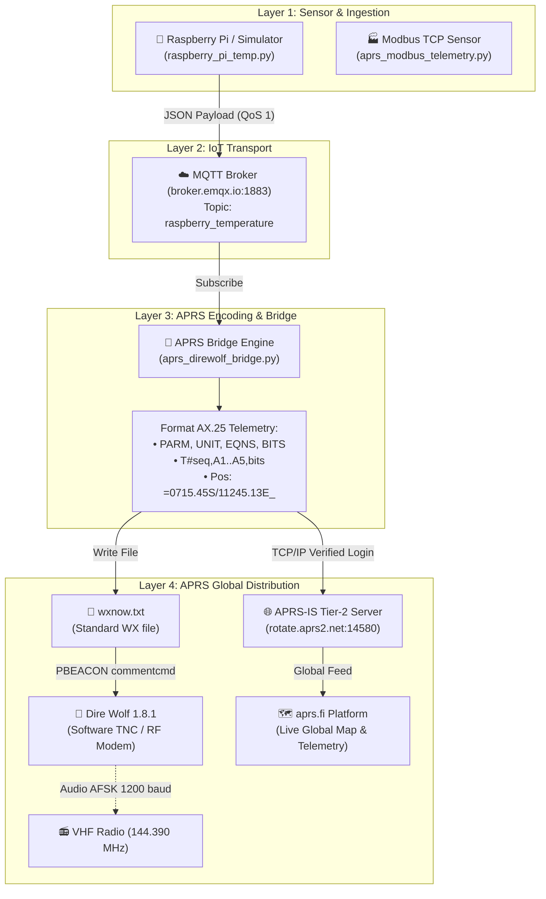

# 📡 IoT APRS Telemetry & Weather Station via Dire Wolf, MQTT & APRS-IS

[](https://www.python.org/)
[](https://www.emqx.com/)
[](http://www.aprs.org/)
[](https://github.com/wb2osz/direwolf)
[](https://aprs.fi/#!call=YD3ADB-3)

An end-to-end Internet of Things (IoT) telemetry system that collects **Raspberry Pi CPU Temperature** (or industrial **Modbus TCP** sensor data), transmits it via **MQTT**, encodes it into standard **APRS (Automatic Packet Reporting System) AX.25 Telemetry packets**, and injects it into the global **APRS-IS** network to be monitored live on [aprs.fi](https://aprs.fi/#!call=YD3ADB-3), with full integration into **Dire Wolf Software TNC**.

---

## 🌟 Key Features

- **🌐 Live Global APRS-IS Integration:** Authenticates directly with Tier-2 APRS-IS servers (`rotate.aprs2.net:14580`) using callsign **`YD3ADB-3`** with verified passcode authentication.
- **📊 Real-Time Telemetry on aprs.fi:** Streams telemetry data (`T#`), station position (`=`), and telemetry metadata definitions (`PARM`, `UNIT`, `EQNS`, `BITS`).
- **☁️ MQTT Transport Layer:** Lightweight publish/subscribe pipeline over public/private brokers (`broker.emqx.io:1883`) on topic `raspberry_temperature`.
- **🌡️ Dual Mode Sensor Engine:**
  - **Real Hardware Mode:** Reads live thermal data from `/sys/class/thermal/thermal_zone0/temp` on Raspberry Pi Linux.
  - **Simulation Mode:** Realistic Gaussian noise + sinusoidal CPU heating/cooling simulation for testing on PC/Windows without hardware.
- **🐺 Dire Wolf TNC Compatibility:** Continuously generates and updates `wxnow.txt` for Dire Wolf's `PBEACON` weather/telemetry broadcast.
- **🏭 Industrial Modbus TCP Support:** Includes scripts to poll industrial Modbus TCP sensors (temperature & humidity) and convert them to APRS telemetry.

---

## 🗺️ Live Monitoring Links

| Service | Link |
|---|---|
| 📍 **aprs.fi Station Map** | [https://aprs.fi/#!call=YD3ADB-3](https://aprs.fi/#!call=YD3ADB-3) |
| 📈 **aprs.fi Live Telemetry Chart** | [https://aprs.fi/telemetry/a/YD3ADB-3](https://aprs.fi/telemetry/a/YD3ADB-3) |

---

## 🏗️ System Architecture



---

## 📂 Repository Structure

```text
├── aprs_direwolf_bridge.py    # MQTT Subscriber -> APRS Telemetry Encoder -> APRS-IS & wxnow.txt
├── raspberry_pi_temp.py       # Raspberry Pi CPU Temp Reader / Simulator -> MQTT Publisher
├── aprs_modbus_telemetry.py   # Modbus TCP Sensor -> APRS Telemetry encoder
├── main.py                    # Modbus TCP Sensor -> MQTT publisher
├── config.json                # Central configuration (Modbus, MQTT, APRS callsign & passcode)
├── direwolf.cfg               # Ready-to-use Dire Wolf TNC configuration file
├── wxnow.txt                  # Real-time weather telemetry file (read by Dire Wolf)
├── aprs_packets.log           # Continuous packet log of all transmitted APRS frames
├── requirements.txt           # Python dependencies
├── LAPORAN_UTS.md             # Full academic lab report (Indonesian)
├── DOKUMEN_PENGUMPULAN_EDLINK.md # Course submission summary document
└── direwolf-1.8.1-a231971_x86_64/
    └── direwolf-1.8.1-a231971_x86_64/
        ├── direwolf.exe       # Pre-compiled Dire Wolf binary for Windows x64
        └── direwolf.conf      # Dire Wolf configuration template
```

---

## 🚀 Quick Start Guide

### 1. Clone & Install Dependencies

```bash
git clone https://github.com/your-username/iot-aprs-telemetry.git
cd iot-aprs-telemetry
pip install -r requirements.txt
```

### 2. Run the APRS Bridge (Terminal 1)

This subscribes to MQTT, connects to APRS-IS, and writes `wxnow.txt`:

```bash
python aprs_direwolf_bridge.py
```

*Expected output:*
```text
APRS-IS banner    : # aprsc 2.1.21-gbfc2090
APRS-IS login resp: # logresp YD3ADB verified, server T2DALLAS
✅ APRS-IS: login berhasil sebagai YD3ADB-3
✅ MQTT terhubung ke broker.emqx.io:1883
   Subscribe topic: raspberry_temperature
```

### 3. Run the Temperature Publisher (Terminal 2)

```bash
# PC / Laptop (Simulation Mode - default):
python raspberry_pi_temp.py --interval 5

# On actual Raspberry Pi Linux hardware:
python raspberry_pi_temp.py --real --interval 5
```

*Expected output:*
```text
✅ Terhubung ke MQTT broker broker.emqx.io:1883
   Topic publish: raspberry_temperature
[#0001] 🌡  Suhu CPU = 52.05 °C  → dikirim ke 'raspberry_temperature'
[#0002] 🌡  Suhu CPU = 53.45 °C  → dikirim ke 'raspberry_temperature'
```

### 4. Monitor Live on aprs.fi

Open your web browser:
- **Station Location:** [https://aprs.fi/#!call=YD3ADB-3](https://aprs.fi/#!call=YD3ADB-3)
- **Telemetry Charts:** [https://aprs.fi/telemetry/a/YD3ADB-3](https://aprs.fi/telemetry/a/YD3ADB-3)

---

## 🧮 APRS Telemetry Protocol Details

APRS Telemetry packets encode 5 analog channels (raw `0`–`255`) and 8 digital bits.

### Telemetry Packet Example
```text
YD3ADB-3>APRS,TCPIP*:T#000,113,000,000,000,000,00000000
```
- `T#000`: Sequence number (000–999).
- `113`: Raw byte value for Channel 1 (CPU Temperature).
- `000,000,000,000`: Channels 2–5 (reserved/unused).
- `00000000`: 8 digital status bits (Bit 1 activates when Temperature > 70 °C).

### Conversion Formula
The receiver decodes the analog channel using quadratic coefficients ($a, b, c$):

$$V = a \cdot x^2 + b \cdot x + c$$

In our setup (`EQNS.0,0.5,0`), $a = 0$, $b = 0.5$, and $c = 0$:

$$T_{\text{decoded}} = 0.5 \times \text{raw}$$

$$\text{raw} = 113 \implies T = 0.5 \times 113 = 56.50^\circ\text{C} \quad (\text{Actual Sensor: } 56.53^\circ\text{C})$$

---

## 🐺 Dire Wolf TNC Integration

Dire Wolf can read weather telemetry directly from `wxnow.txt` and transmit it over VHF radio or IGate:

In `direwolf.cfg`:
```conf
MYCALL YD3ADB-3
CHANNEL 0
MODEM 1200

# Periodic position & weather beacon:
PBEACON delay=0:30 every=10:00 lat=-7.2575 long=112.7521 symbol="_" \
        comment="RPi CPU Temp" commentcmd="type wxnow.txt"

# Internet Gateway (IGate) to APRS-IS:
IGSERVER rotate.aprs2.net
IGLOGIN YD3ADB-3 23973
```

To run Dire Wolf standalone on Windows:
```powershell
cd direwolf-1.8.1-a231971_x86_64\direwolf-1.8.1-a231971_x86_64
.\direwolf.exe -c direwolf.conf
```

---

## 📄 Configuration (`config.json`)

```json
{
  "modbus": {
    "host": "10.10.0.100",
    "port": 502,
    "device_id": 1,
    "register_address": 0,
    "register_count": 2,
    "scale": 10
  },
  "mqtt": {
    "host": "broker.emqx.io",
    "port": 1883,
    "topic": "raspberry_temperature",
    "client_id": "modbus-mqtt-sensor-uts"
  },
  "aprs": {
    "callsign": "YD3ADB-3",
    "aprs_is": {
      "server": "rotate.aprs2.net",
      "port": 14580,
      "passcode": 23973,
      "filter": "r/-7.2575/112.7521/50"
    }
  }
}
```

---

## 👨‍💻 Author & Acknowledgments

- **Author:** Almuza Fajar
- **Callsign:** `YD3ADB` (ORARI / SDPPI Indonesia)
- **Course:** Internet of Things (IoT) — 5th Semester
- **License:** MIT License

